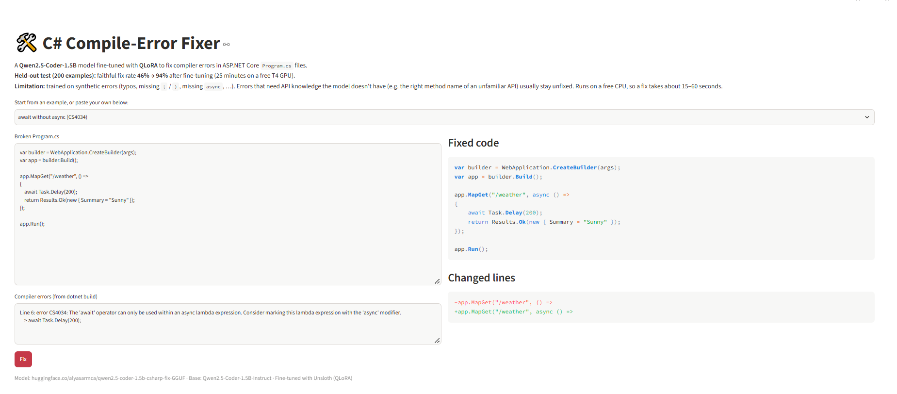
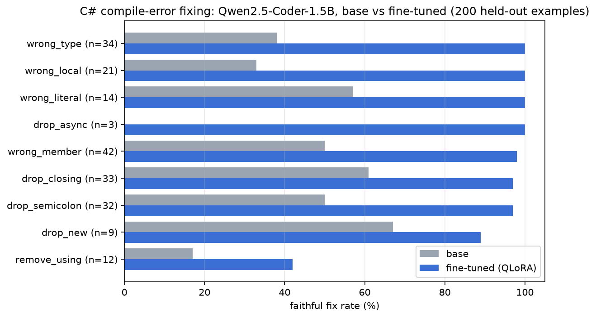
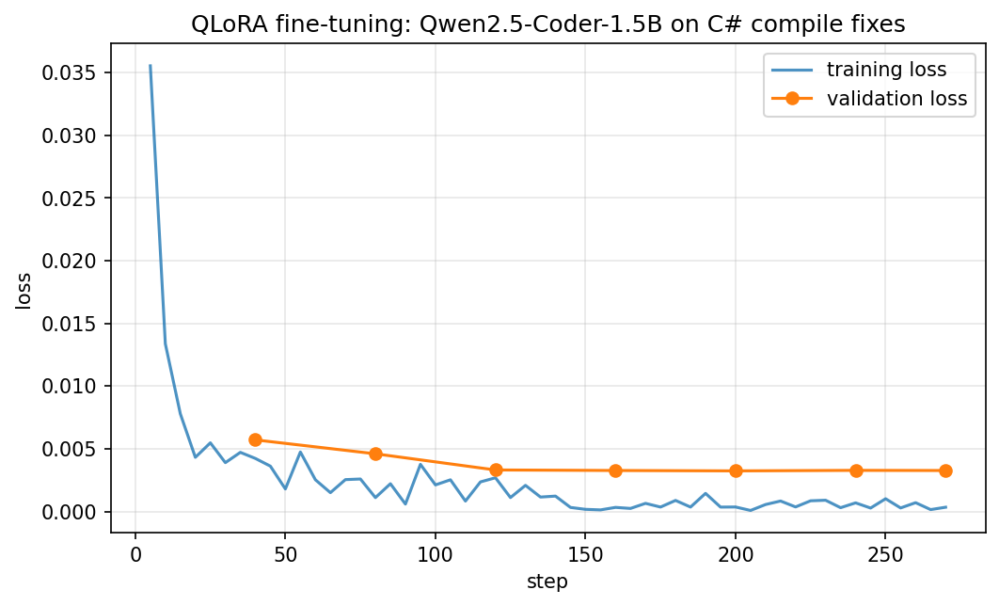

# 🛠️ C# Compile-Error Fixer: QLoRA fine-tuning of a 1.5B code model

A small open-source model (**Qwen2.5-Coder-1.5B-Instruct**) fine-tuned with **QLoRA** to fix compiler errors in ASP.NET Core `Program.cs` files: given broken code and the `dotnet build` errors, it returns the corrected file.
Training data was **generated and verified with the real C# compiler**, the model was trained for **25 minutes on a free Colab T4**, and every result is measured by **compiling the model's answers**.

**🔗 Live demo:** https://csharp-fix-lora.streamlit.app/
**🤗 Model:** [LoRA adapter](https://huggingface.co/alyasarmca/qwen2.5-coder-1.5b-csharp-fix-lora) · [GGUF (4-bit, runs on CPU)](https://huggingface.co/alyasarmca/qwen2.5-coder-1.5b-csharp-fix-GGUF)



---

## Results at a glance

200 held-out examples, built from programs the model **never saw in training** (split by near-duplicate clusters, see below).

| | Base model | Fine-tuned | Change |
|---|---|---|---|
| Fix compiles | 66% | **96%** | +30 pts |
| **Faithful fix** (compiles, nothing deleted, ≤ 2 lines different from the original) | 46% | **94%** | **+48 pts** |
| Exact match with the original code | 22% | **90%** | +68 pts |
| "Fixed" the error by **deleting original code** | 16% | **3%** | −13 pts |
| Median lines changed vs. the original | 2 | **0** | |

| Training cost | |
|---|---|
| Hardware | Free Google Colab **T4** (16 GB) |
| Training time | **25.2 minutes** (2 epochs, 270 steps) |
| Peak GPU memory | **1.8 GB** |
| Trained parameters | **18.5M of 1.56B (1.18%)** |
| Money spent | **$0** |

**Key findings**
1. **Fine-tuning doubled the faithful-fix rate (46% → 94%)** and taught the model to make *minimal* edits: the base model often "fixed" errors by deleting code or rewriting lines nobody asked about.
2. **The remaining failures are knowledge, not behaviour.** 8 of the 11 failures need a missing `using` (which namespace a type lives in). Fine-tuning teaches *how* to fix; it does not teach facts the data doesn't contain.
3. **The gains do not transfer to real-world API errors (0 / 4).** On real build failures made by an LLM in my [multi-agent project](https://github.com/Alyasar) (e.g. `WithDuration` instead of `Expire`), neither the base nor the fine-tuned model succeeded. The model learned the training distribution, not general C# API knowledge. See [Limitations](#limitations-and-honest-caveats).



---

## How it works

```
Microsoft docs samples (GitHub)          ┌──────────── Local PC (.NET 10 SDK) ────────────┐
   │  sparse clone: only *.cs files      │                                                 │
   ▼                                     │                                                 │
#if-variant expansion ──► compile each ──► 367 compiling "seed" programs                   │
                                         │        │                                        │
                                         │        ▼  9 mutation operators (seeded)          │
                                         │  broken versions ──► compile again ──► keep only │
                                         │  the ones that really fail + their real errors   │
                                         │        │                                        │
                                         │        ▼                                        │
                                         │  2,692 examples ──► cluster near-duplicates ──►  │
                                         │  split by cluster: train 2,146 / val 139 / test 407
                                         └────────┬────────────────────────────────────────┘
                                                  ▼
                       ┌────────── Google Colab (free T4) ──────────┐
                       │ base model eval ─► QLoRA fine-tuning ─►     │
                       │ fine-tuned eval ─► export LoRA + GGUF ─► HF │
                       └────────┬───────────────────────────────────┘
                                ▼
            Local PC: compile every answer ─► metrics, charts
                                ▼
            Streamlit app (llama.cpp, CPU) ─► downloads the GGUF from the Hugging Face Hub
```

| Component | Choice |
|---|---|
| Base model | `Qwen2.5-Coder-1.5B-Instruct` (via Unsloth, 4-bit) |
| Method | QLoRA: frozen 4-bit base + LoRA adapters (rank 16, alpha 16) on all attention and MLP projections |
| Loss | **On the answer only** (`train_on_responses_only`): the model learns to write fixes, not to repeat the prompt |
| Training | 2 epochs, effective batch 16 (4 × 4 accumulation), LR 2e-4 cosine, 8-bit AdamW, fp16; best checkpoint by validation loss |
| Data verification | Real `dotnet build` (.NET 10) in 4 parallel sandbox projects |
| Serving | GGUF `Q4_K_M` with `llama-cpp-python` on Streamlit Community Cloud (CPU) |

---

## The data: built and verified with the compiler

**1. Seeds: real programs that compile** ([`notebooks/01_collect.ipynb`](notebooks/01_collect.ipynb))
- Source: `*.cs` files from [dotnet/AspNetCore.Docs](https://github.com/dotnet/AspNetCore.Docs) and [dotnet/AspNetCore.Docs.Samples](https://github.com/dotnet/AspNetCore.Docs.Samples) (MIT-licensed code) that use `WebApplication.CreateBuilder`, plus 38 programs from my multi-agent project.
- Many docs files contain **several programs switched with `#define` / `#if`**. [`variants.py`](variants.py) expands each file into one clean program per variant: **423 files → 1,057 variants**. This raised the number of seeds from 68 to 367.
- Every candidate is compiled; only programs that **build on their own** are kept (48%; the rest need other project files or NuGet packages).

**2. Breaking the code on purpose** ([`mutations.py`](mutations.py), [`notebooks/02_corrupt.ipynb`](notebooks/02_corrupt.ipynb))

| Operator | Example | Typical error |
|---|---|---|
| `drop_semicolon` | `app.Run()` | CS1002 |
| `drop_closing` | `new Item("a", true;` | CS1026 / CS1513 |
| `wrong_member` | `UseCors` → `AddCors`, `CreateBuilders` | CS1061 / CS0117 |
| `wrong_type` | `WebAppication` | CS0246 / CS0103 |
| `wrong_local` | `buildeer.Services…` | CS0103 |
| `remove_using` | a needed `using` line deleted | CS0246 / CS1061 |
| `wrong_literal` | `10` → `"10"`, `"fixed"` → `fixed` | CS1503 / CS0029 |
| `drop_async` | `await` inside a lambda without `async` | CS4034 |
| `drop_new` | `return Item("a", true)` | CS1955 |

Design rules:
- **Every mistake must be recoverable from the input.** An early "delete an argument" operator removed whole lambdas that no model could reinvent, so it was dropped.
- **Mistakes are never placed inside strings or comments** (a small C# tokenizer finds safe positions).
- **Every broken version is compiled; only real failures are kept**, with the compiler's actual messages as model input. 2,744 candidates → **2,692 examples** (14% contain two mistakes).
- Everything is **seeded**, so the dataset is reproducible.

**3. Splitting without leakage** ([`notebooks/03_split.ipynb`](notebooks/03_split.ipynb))
The docs contain near-identical copies of samples (e.g. the same app for .NET 6 and .NET 7). If one copy is in training and the other in testing, the test score is inflated. Seeds that are **≥ 80% similar are clustered together** (union-find; 127 source groups → 80 clusters, 47 merges), and the split is made **by cluster**: no cluster appears in both train and test.

| Split | Examples | Clusters | Seeds |
|---|---|---|---|
| Train | 2,146 (80%) | 51 | 296 |
| Validation | 139 (5%) | 8 | 16 |
| Test | 407 (15%) | 21 | 55 |

Evaluation uses a fixed random **200** of the 407 test examples for both models.

---

## Evaluation: compile the answers

Exact match is too strict (a harmless extra `using` counts as a miss) and a plain compile rate is too lenient (deleting the broken line also compiles). So each answer is **compiled** and compared line by line with the original ([`scoring.py`](scoring.py), [`notebooks/04_score.ipynb`](notebooks/04_score.ipynb)):

- **Compiles:** the fixed file builds.
- **Faithful fix (main metric):** compiles **and** no original line was deleted **and** at most 2 lines differ from the original.
- **Exact:** identical to the original (ignoring whitespace and blank lines).

Base and fine-tuned model were evaluated under identical conditions: same 200 examples, 4-bit weights, greedy decoding, batches of 8.

**Per example:** 98 fixed only by the fine-tuned model, 91 by both, **2 regressions** (fixed only by the base model), 9 by neither.

### Training curves



Validation loss falls until about step 120 and is flat afterwards; there is no overfitting, and the best checkpoint (step 200) was kept. **One epoch would very likely have been enough**, halving training time. The loss is tiny (~0.003) because ~95% of every answer is copied from the input; that is why the model is judged by compiling its answers, not by its loss.

### Real-world test: errors made by an LLM

| Real build failure | Needs | Base | Fine-tuned |
|---|---|---|---|
| `policy.Expiration = …` (should be `Expire(…)`) | API knowledge | ✗ | ✗ |
| `c.WithDuration(10)` (should be `Expire(…)`) | API knowledge | ✗ | ✗ |
| `RateLimiterPartition` (should be `RateLimitPartition`) | API knowledge | ✗ | ✗ |
| `Results.Text(content, type, (int)status)` (3rd parameter is `Encoding`) | Overload knowledge | ✗ | ✗ |

These are the cases where `gpt-oss-120b` itself failed after 4 compile-and-retry attempts, so they are hard. The interesting difference is *how* the models failed: the base model rewrote freely (adding 5 unrequested `using` lines); the fine-tuned model changed almost nothing. It became **conservative**: when it doesn't know, it doesn't damage the file.

---

## Limitations and honest caveats

- **Synthetic errors.** The test errors are generated the same way as the training errors. The 94% describes this distribution; the real-world test (0 / 4) shows it does not cover API-knowledge errors.
- **Knowledge gaps need tools, not fine-tuning.** Missing `using` lines (42% after fine-tuning) and unknown API names would be better solved with a type → namespace lookup (like the IDE's "Add using") or retrieval from the docs, given to the model as extra context.
- **Small numbers per operator.** Some operators have few test examples (`drop_async` 3, `drop_new` 9, `remove_using` 12); treat those rates as indicative. One run, greedy decoding.
- **Training-data variety.** One family of similar programs (115 seeds) makes up about 30% of the training examples. It never reaches the test set, but it limits variety.
- **The demo model is a different 4-bit format.** Scores were measured with bitsandbytes 4-bit in Colab; the demo uses the merged GGUF `Q4_K_M` with llama.cpp. Quality should be very close but was not re-measured.
- **The demo cannot compile.** The free host has no .NET SDK, so you paste the compiler errors yourself.
- **Two "failures" are probably correct.** In two `remove_using` cases the model added a different `using` that also compiles; the strict faithful-fix rule counts them as misses.

## Next steps

1. Add a type → namespace table / docs retrieval as context, and re-measure `remove_using` and the real-world set.
2. More realistic mutations: replace a real API member with a *different real* member, and add real LLM build failures to the training data.
3. Train for one epoch and compare; try a 7B base model for more built-in API knowledge.
4. Measure the GGUF `Q4_K_M` model on the same 200 examples.

---

## Project structure

```
csharp-fix-lora/
├── app.py                    # Streamlit demo (llama.cpp + GGUF from the Hugging Face Hub)
├── csharp.py                 # Compile C# in sandbox projects (parallel), parse compiler errors
├── variants.py               # Expand #define/#if files into one program per variant
├── mutations.py              # The 9 mutation operators (tokenizer-aware, seeded)
├── scoring.py                # Compile answers, faithful-fix / exact / deleted-code metrics
├── notebooks/
│   ├── 01_collect.ipynb      # Find and compile seed programs
│   ├── 02_corrupt.ipynb      # Break them, keep real failures
│   ├── 03_split.ipynb        # Near-duplicate clustering, train/val/test, chat format
│   ├── 04_score.ipynb        # Compile and compare model answers, charts, real-world test
│   └── colab/
│       ├── 05_baseline_eval.ipynb   # Base model predictions (T4)
│       ├── 06_finetune.ipynb        # QLoRA training, curves, fine-tuned predictions (T4)
│       └── 07_export.ipynb          # Upload LoRA adapter + GGUF to the Hugging Face Hub
├── data/processed/           # seeds, examples, train/val/test, real_errors (JSONL)
├── evals/                    # predictions and scored results
├── reports/                  # comparison.csv, training_log.csv, charts
├── requirements.txt          # The app's dependencies (Streamlit Cloud)
└── packages.txt              # System packages for building llama.cpp on Streamlit Cloud
```

## Run it yourself

**Data and scoring (local, needs the .NET 10 SDK):**
```powershell
git clone https://github.com/Alyasar/csharp-fix-lora.git
cd csharp-fix-lora
python -m venv .venv
.\.venv\Scripts\Activate.ps1
python -m pip install pandas tqdm matplotlib ipykernel
# Re-create data/raw (only *.cs files of the two Microsoft repos):
cd data\raw
git clone --depth 1 --filter=blob:none --sparse -c core.longpaths=true https://github.com/dotnet/AspNetCore.Docs.git
cd AspNetCore.Docs; git sparse-checkout set --no-cone "*.cs"; cd ..
git clone --depth 1 --filter=blob:none --sparse -c core.longpaths=true https://github.com/dotnet/AspNetCore.Docs.Samples.git
cd AspNetCore.Docs.Samples; git sparse-checkout set --no-cone "*.cs"; cd ..\..\..
# Then run notebooks 01 -> 04 in order.
```

**Training:** open the notebooks in `notebooks/colab/` in Google Colab with a T4 runtime, and put `data/processed/{train,val,test,test_eval}.jsonl` in `My Drive/csharp-fix-lora/data/`.

**Demo locally:**
```powershell
python -m pip install llama-cpp-python --extra-index-url https://abetlen.github.io/llama-cpp-python/whl/cpu
python -m pip install huggingface_hub streamlit
streamlit run app.py
```

## Tech stack

Python · Unsloth · Hugging Face Transformers / TRL / PEFT · QLoRA · bitsandbytes · llama.cpp (GGUF) · Streamlit · pandas · matplotlib · .NET 10 SDK · Google Colab · Hugging Face Hub

## Acknowledgements

Seed programs come from Microsoft's [AspNetCore.Docs](https://github.com/dotnet/AspNetCore.Docs) and [AspNetCore.Docs.Samples](https://github.com/dotnet/AspNetCore.Docs.Samples) repositories (code under the MIT license). Base model: [Qwen2.5-Coder-1.5B-Instruct](https://huggingface.co/Qwen/Qwen2.5-Coder-1.5B-Instruct) (Apache 2.0). Fine-tuning with [Unsloth](https://github.com/unslothai/unsloth).
